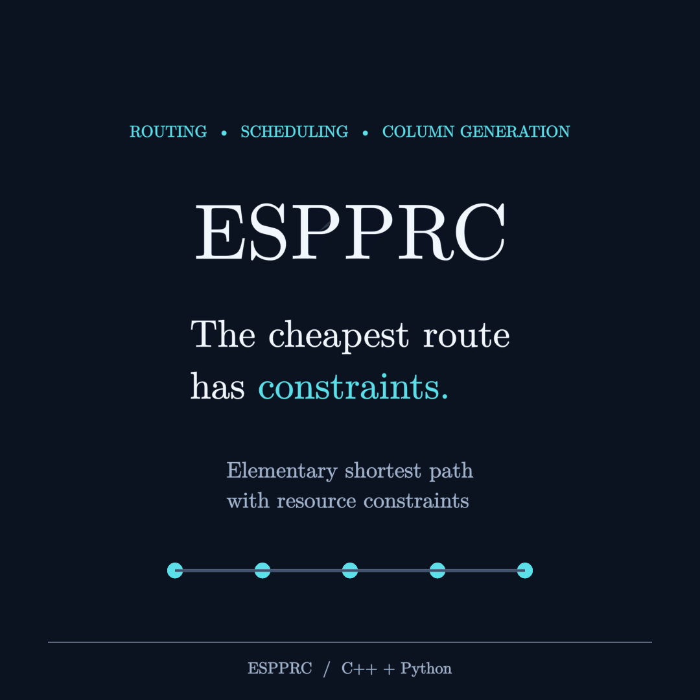

# ESPPRC

ESPPRC builds on [cspy](https://github.com/torressa/cspy)'s C++ bidirectional
labeling implementation by David Torres Sanchez. It extends that implementation
with adaptive bucket screening, faster label joining, SRI-aware costs and
optional parallel preparation. The upstream MIT copyright and license are
preserved in [licenses/cspy.txt](licenses/cspy.txt).

A C++17/Cython elementary shortest path solver with resource constraints. The
bidirectional labeling uses adaptive resource buckets, conservative dominance
and join screening, duplicate-label indexing, and optional OpenMP preparation
of extensions and joins. Serial execution is the default; parallel execution
helps some workloads and adds overhead on others.

The project includes Python and native regressions, exhaustive small-graph
checks, and seven portable pricing fixtures. No SVDRP checkout or temporary
files are needed. Project contributions are MIT licensed; upstream/dependency
notices are in [NOTICE](NOTICE) and [licenses/](licenses/).

## Watch the problem explained

[](docs/video/media/espprc_showcase.mp4)

[Watch or download the video](docs/video/media/espprc_showcase.mp4). The silent
square-format explainer includes a solver-verified routing example, bidirectional
labeling, dominance and bucket screening. [Manim source, captions and render
instructions](docs/video/README.md) are included; video dependencies are optional.

## Install from source

Use Python 3.9 or newer, a C++17 compiler and CMake 3.22 or newer:

```bash
git clone https://github.com/rezamirjaliliphd/ESPPRC.git
cd ESPPRC
python -m pip install ".[test]"
```

The pip build uses scikit-build-core and regenerates the wrapper from the active
`Bidirectional.pyx` and `.pxd`. CMake looks for LEMON, fmt and spdlog, downloading
missing dependencies. The first build needs network access unless dependencies
are preinstalled. Conda users can run `conda env create -f environment.yml`.
On Ubuntu/Debian, preinstall native dependencies with:

```bash
sudo apt-get install g++ cmake liblemon-dev libfmt-dev libspdlog-dev
python -m pip install ".[test]" --config-settings=cmake.define.ESPPRC_VENDOR_DEPS=OFF
```

For custom installations, pass `cmake.define.CMAKE_PREFIX_PATH`, and, if needed,
`cmake.define.LEMON_INCLUDE_DIR` and `cmake.define.LEMON_LIBRARY`. To disable OpenMP:

```bash
python -m pip install . --config-settings=cmake.define.ESPPRC_ENABLE_OPENMP=OFF
```

Parallel options then safely fall back to serial execution. Linux is verified
locally. The included CI workflow covers Linux Python versions and OpenMP modes;
Windows/macOS support is not claimed as release-tested.

## Solve a graph

```python
import networkx as nx
from espprc import solve_espprc

graph = nx.DiGraph()
graph.add_edge("start", "customer", weight=-3, res_cost=[2, 1])
graph.add_edge("customer", "end", weight=1, res_cost=[2, 0])
graph.add_edge("start", "end", weight=0, res_cost=[1, 0])
result = solve_espprc(graph, min_res=[0, 0], max_res=[5, 2],
                     cg_cut_pi=[0, 0], source="start", sink="end")
path = [result["id_to_node"][i] for i in result["path"]]
print(path, result["cost"])  # ['start', 'customer', 'end'], -2.0
```

Each directed edge needs `weight` and `res_cost`. Returned paths contain internal
integer IDs; use `id_to_node` to recover original labels. An empty path means the
search returned no path; its cost is not an optimality certificate.

Resources are additive. Complete path cost is
`sum(edge weights) + sum(pi[r] * floor(resource[r]))`. The SRI regressions use
nonnegative `cg_cut_pi` coefficients: these are signed cost penalties, not the
original nonpositive master duals. The tested pricing regime uses nonnegative
resource increments and an increasing bounded critical resource. Arbitrary
signed floor costs or arbitrary resource-extension functions are not covered
by an exactness guarantee.

Interface limits:

- `elementary=True` forbids repeated nodes. K-cycle elimination with
  `elementary=False` is a relaxation and does not establish elementarity.
- `get_all_path=True` returns collected search paths, not all feasible paths;
  dominance can discard feasible alternatives.
- `time_limit` and `threshold` can stop early. The return dictionary currently
  has no certified bound/termination-status field. Omit both for completed solves.
- `use_bitwise=True` requires at most 64 graph nodes; otherwise use set mode.
- The legacy `use_time_windows` flag does not load node-specific windows through
  this wrapper. It is not a verified customer-time-window implementation.

## Optimization controls

`adaptive_buckets`, `bucket_dominance`, `bucket_extension`, and `bucket_joining`
default to true. Initial `bucket_width` is 5 critical-resource units.
`enable_parallel=True` prepares extensions; `parallel_joining=True` prepares
joins. Set `num_threads` explicitly. Dominance/insertion retain serial order.
`profile_dominance`, `profile_extension`, and `profile_joining` add stage counters
and timings. Disable profiling for runtime comparisons.

## Bundled data and benchmarks

```python
from espprc.datasets import available_instances, load_instance
graph, options, metadata = load_instance("drone20")
result = solve_espprc(graph, **options)
print(available_instances(), result["cost"])
```

Checksummed JSON fixtures ship inside the wheel. `drone20` is a frozen generated
research pricing input; the other six are explicitly synthetic. See
[benchmarks/README.md](benchmarks/README.md) for provenance and the protocol.
Recorded development outputs provide replay checks; small exhaustive tests
provide independent optimality checks.

```bash
python benchmarks/run.py --repeats 5 --threads 4 --output benchmark-results
```

The runner compares complete outputs across serial, extension, joining and
combined modes, rotates timing order, and records raw CSV timings and environment
metadata. Historical selected measurements are in `benchmarks/history/`.

## Tests

```bash
python -m pytest -q
python -m pip install Cython
cmake -S . -B build-tests -DESPPRC_BUILD_TESTS=ON -DCMAKE_BUILD_TYPE=Release \
  -DPython3_EXECUTABLE="$(python -c 'import sys; print(sys.executable)')"
cmake --build build-tests --parallel 2
ctest --test-dir build-tests --output-on-failure
```

Repeat in a fresh build directory with `-DESPPRC_ENABLE_OPENMP=OFF` to check the
serial fallback. Native tests use explicit checks active in Release builds.
Python assertion failures propagate instead of being printed and swallowed.
See [docs/DEVELOPMENT.md](docs/DEVELOPMENT.md) for source/wheel verification.

## Research and upstream credits

The underlying bidirectional solver and basic label-dominance machinery derive
from cspy. Our extensions and engineering changes do not imply authorship of
those underlying algorithms or endorsement by the upstream authors.

- Torres Sanchez, D. (2020). *cspy: A Python package with a collection of
  algorithms for the (Resource) Constrained Shortest Path problem*.
  Journal of Open Source Software, 5(49), 1655.
  [DOI: 10.21105/joss.01655](https://doi.org/10.21105/joss.01655).
- Jepsen, M., Petersen, B., Spoorendonk, S., and Pisinger, D. (2008).
  *Subset-Row Inequalities Applied to the Vehicle-Routing Problem with Time
  Windows*. Operations Research, 56(2), 497–511.
  [DOI: 10.1287/opre.1070.0449](https://doi.org/10.1287/opre.1070.0449).
  This is the SRI reference; ESPPRC implements pricing costs for supplied cut
  coefficients, not a master problem or a cut separator.

The explainer was made with [3Blue1Brown's ManimGL](https://github.com/3b1b/manim).
Machine-readable references are in [docs/video/references.bib](docs/video/references.bib).
